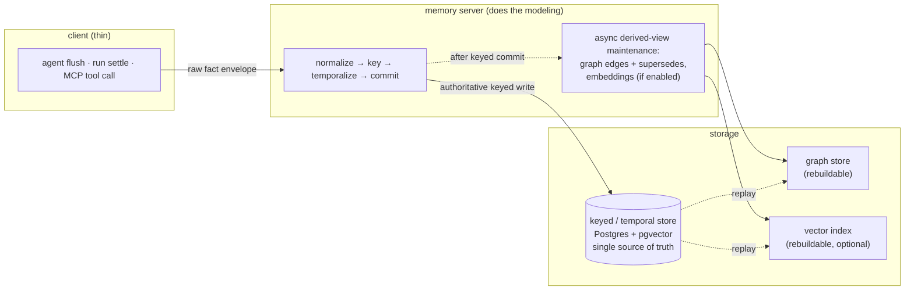
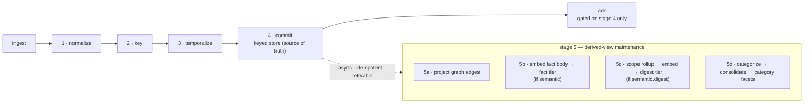
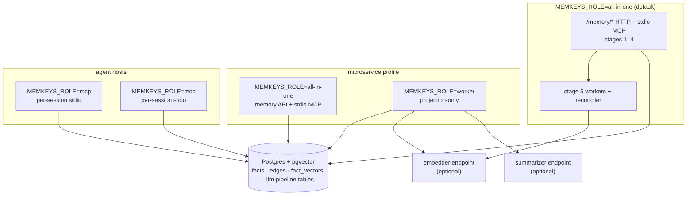
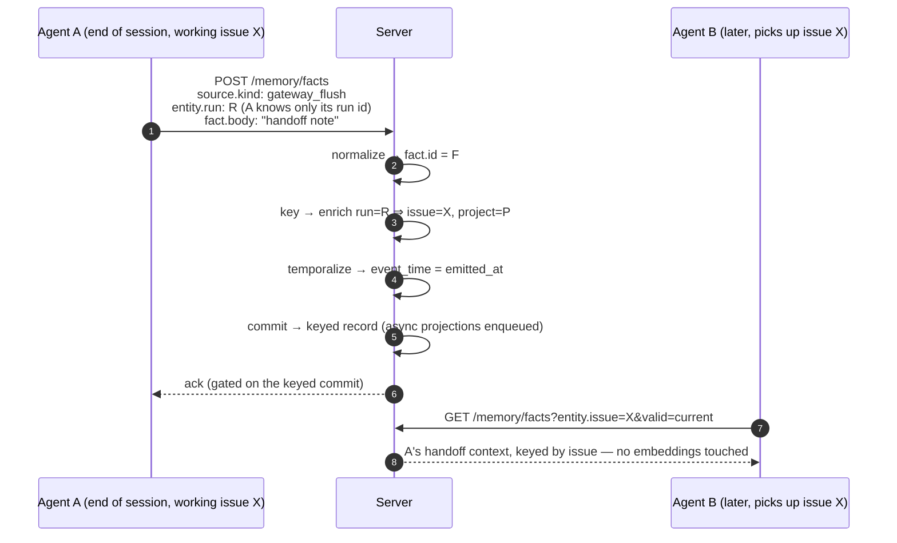

# MemKeys — Architecture

MemKeys is an attribute-based memory server: facts keyed by agent-supplied
attributes, temporal validity, graph and vector as derived views, behind a
small open retrieval contract with pluggable backends. This page is the
architecture of the shipped server — the storage model, the fact envelope,
the write pipeline, and the retrieval contract. New to MemKeys? Start with
[What is MemKeys](/memkeys/what-is-memkeys/) or the
[Quickstart](/memkeys/quickstart/).

The one invariant that organizes everything:

> **Attribute keys bound the candidate set before any vector or graph work.
> The keyed / temporal store is the single source of truth; graph and vector
> are derived, rebuildable projections.**

## Overview



The server does the modeling. Clients push raw facts; the server normalizes
them, validates and enriches the entity keys, applies temporal semantics
(validity windows and supersession links), writes the authoritative keyed
record, and maintains the derived indexes asynchronously.

## Why keyed-first

Most memory reads an agent issues are not fuzzy. "Pick up issue X" wants
*everything known about X* — prior decisions, the last run outcome, the
handoff note a previous agent left. That is a deterministic lookup by key,
not a similarity search. Making the default path a keyed fetch means:

- **Deterministic and reproducible.** The same key returns the same set; no
  ranking drift, no embedding-model dependence, no false neighbors.
- **Cheap.** No vector math on the hot path — a filtered scan over an indexed
  dimension.
- **Portable.** Any store that can "filter records by field + time range" can
  serve the keyed path. The semantic tier, the part that varies most across
  backends, is pushed to the edge as a replaceable index.
- **Honest failure mode.** A keyed miss means "nothing recorded about X", not
  "the embedding didn't surface it". Discovery ambiguity is confined to the
  semantic tier where it belongs.

Semantic search earns its place for the genuinely open question ("has anyone
hit an outage like this before?") — but it is answered *within* a keyed scope
wherever one is known, and never as the primary retrieval path.

## The fact envelope

A producer pushes a **raw** fact. The envelope carries *hints*, not
authority — the server is the authority on keys, time, and supersession.

```jsonc
{
  "source": {
    "kind": "gateway_flush | run_settle | a2a_exchange | telemetry_learning",  // required
    "producer": "<agent or gateway id>",  // advisory; server-verified against the caller principal
    "emitted_at": "<RFC3339 timestamp>"   // required; client clock, default for fact.event_time
  },
  "entity": {                             // client-asserted key hints — validated/enriched server-side
    "project": "<id>",                    // hint; normally server-enriched, not sent
    "issue":   "<id>",                    // hint; normally server-enriched, not sent
    "pr":      "<id>",                    // hint; normally server-enriched, not sent
    "agent":   "<id>",                    // = the authenticated producer agent (server-verified)
    "run":     "<id>",                    // anchor for gateway_flush / run_settle
    "thread":  "<id>",                    // anchor for a2a_exchange
    "service": "<id>",                    // anchor-hint for telemetry_learning
    "counterpart_agent": "<id>"           // a2a only; hint, corroborated against thread membership
  },
  "fact": {
    "type": "decision | outcome | observation | learning | context",  // optional; server defaults per source.kind
    "body": "<natural-language text OR structured payload>",          // required — the one thing only the producer can supply
    "subject": "<what within the entity this fact is about>",         // optional; required when `supersedes` is set
    "event_time": "<RFC3339>",           // optional; when it happened; defaults to emitted_at
    "confidence": 0.0,                   // optional; SHOULD be set for type=learning
    "supersedes": "<prior fact id>"      // optional; server validates the target shares (entity, subject, type)
  },
  "provenance": { },                     // must be absent — server stamps principal/custody/trace from the verified caller
  "attachments": [ ]                     // optional refs (doc ids, blob uris); never inlined
}
```

Design rules:

- **Raw in, modeled server-side.** The producer never computes keys, validity
  windows, or embeddings. It reports what it saw.
- **`entity` is a hint block, not trust.** The server validates each asserted
  key and may *enrich* missing ones from context, but never writes a
  custody-sensitive key on a client's unverified say-so. A key that fails
  validation is recorded as a rejected hint, never silently dropped.
- **One mandatory anchor per source.** Each source sends at least the one key
  it natively knows; everything else is optional and enriched. A fact with no
  resolvable anchor is still stored, tagged `unkeyed`, and reachable only
  through the semantic tier — it never pollutes a keyed result set.
- **`fact.body` is the only always-required payload**, plus `source.kind`,
  `source.emitted_at`, and the per-source anchor.
- **`provenance` is server-owned.** A client-supplied provenance block is
  discarded whole, not merged. Principal and trace context are stamped from
  the verified caller.
- **`subject` is the supersession grain.** It names what successive versions
  are versions *of*, so the server can link supersession chains and readers
  can ask for the *current* value. It is required whenever `supersedes` is
  set — you cannot version a statement without naming it.

### Per-source required / allowed / server-owned

Required = what the producer natively knows without modeling (one anchor key
+ the fact body). Allowed = hints the server validates and enriches.
Server-owned = never accepted from the client body.

| Source | Default type | Required (client sends) | Allowed (hints) | Server-enriched from anchor |
|---|---|---|---|---|
| `gateway_flush` | `context` | `kind`, `emitted_at`, **`entity.run`**, `body` | `agent`, `thread`, `subject`, `event_time`, `confidence`, `supersedes`, `attachments` | `project`, `issue`, `pr` (from run binding) |
| `run_settle` | `outcome` | `kind`, `emitted_at`, **`entity.run`**, `body` | `agent`, `subject`, `event_time`, `confidence`, `supersedes`, `attachments` | `project`, `issue`, `pr`, `agent` (from run record) |
| `a2a_exchange` | `observation` | `kind`, `emitted_at`, **`entity.thread`**, `body` (+ `subject` when `type=decision`) | `counterpart_agent`, `issue`, `pr`, `subject`, `event_time`, `confidence`, `supersedes`, `attachments` | `issue`, `pr` (from thread's work item); participant set |
| `telemetry_learning` | `learning` | `kind`, `emitted_at`, **`entity.service`** or `entity.project`, `body` | `issue`, `pr` (rare), `subject`, `event_time`, `confidence` (SHOULD set), `supersedes`, `attachments` | `project` (from service→project map) |

The anchor is what lets a thin client push only its run or thread id and
still produce a fully-keyed fact. `agent` is never required in the body — it
is verified from the authenticated principal or read from the run record. In
agent-to-agent exchanges, `entity.agent` is the verified producer and the
counterpart stays a corroborated hint: one agent cannot mint a verified key
*about* another.

## Key extraction (write-time modeling)

Keys come from three places, in descending authority:

1. **Verified from the caller.** The `agent` key and producer identity are
   bound to the authenticated principal — the server overwrites any client
   claim that disagrees.
2. **Enriched from context.** A `run` id resolves, via the run registry, to
   its `project` / `issue` / `pr`. A `thread` id resolves to its work item.
   Enrichment is corroborated, never guessed.
3. **Accepted as asserted (low-trust fields only).** Free-form keys with no
   custody weight are taken as given and flagged with their hint provenance
   so a reader can weigh them.

Silent key-dropping is forbidden: an unresolvable asserted key is recorded as
a rejected hint on the fact, not discarded.

## Storage model

MemKeys ships a Postgres backend (with the [pgvector](https://github.com/pgvector/pgvector)
extension for the semantic tier). The storage contract is deliberately
backend-portable — anything that can "filter records by field + time range"
(keyed), "graph hop" (graph), and "nearest-neighbor" (semantic, optional) can
implement it.

Each processed fact is **one immutable, append-only record**:

```
timestamp          = fact.event_time   (bi-temporal "valid/event" axis)
ingested_at        = server ingest time (bi-temporal "transaction" axis)
fact.id            server-assigned, stable, idempotency key
fact.type          decision | outcome | observation | learning | context
fact.subject       supersession grain (nullable)
fact.body          text or serialized structured payload
fact.confidence
fact.supersedes    prior fact.id (nullable)
entity.project | issue | pr | agent | run | thread | service
provenance.principal, custody, trace_id, source_kind
keyed              bool — false ⇒ semantic-only
```

**Append-only is a feature.** A new version of a statement is a *new record*
carrying `fact.supersedes = <old id>`. "Currently valid" is computed at read
time — the latest non-superseded record per `(entity, subject, type)`. Full
history stays queryable for audit and as-of replay. This is standard
bi-temporal modeling (event time vs. transaction time) and it falls out
naturally from an append-only log.

Temporal reads answer two distinct questions precisely: *what was true then*
(event time) and *what had we recorded by then* (transaction time).

### Physical layout

"Postgres + pgvector" is not one table — it is one database holding the source
of truth plus every derived projection, created by a linear migration sequence
under `crates/memkeys-server/migrations/`:

| Migration | Table(s) | Role |
|---|---|---|
| `0001_factstore` | `facts` | The keyed / temporal **source of truth**: one immutable row per processed fact, with partial indexes per entity key (`facts_tenant_{project,issue,pr,agent,run,thread,service}_idx`) and a `WHERE keyed` time index for scoped scans. |
| `0002_graph_projection` | `edges` | The **graph projection** — derived, rebuildable, never written directly (see [Derived views](#derived-views)). |
| `0003_fact_vectors` | `fact_vectors` | The **fact tier** of the semantic index. Runs `CREATE EXTENSION vector`; stores one `vector(256)` embedding per fact with an HNSW cosine ANN index. |
| `0004_llm_pipeline` | `derived_keys`, `digests`, `category_facets`, `derivation_runs` | The LLM-derived tier: extracted keys, scope-rollup digests (embedding inline in the digest row), category facets, and the per-artifact derivation bookkeeping that drives catch-up/backfill. |
| `0005_digest_poison_quarantine` | *(alters `derivation_runs`)* | Quarantine stamps for scopes whose rollup deterministically fails, so poison does not re-drive forever. |
| `0006_live_head` | *(alters `facts`)* | `facts.entity_identity` + `facts_live_head_idx` partial index — accelerates the live-head gate in the write path; no write-back to prior rows. |
| `0007_embedding_model_stamp` | *(alters `fact_vectors`, `digests`)* | Stamps each embedded row with the embedder `model_id` so an embedder change triggers re-embedding instead of silently mixing vector spaces. |

Later migrations refine the two structural rows of the story: `facts` stays
append-only (0006 adds a column computed at commit, never rewritten), and the
derived tables stay rebuildable (0005/0007 exist to make *rebuilding* smarter).
What a deployment actually needs to provision — Postgres version, pgvector,
model endpoints — is specified on the [instance requirements](/memkeys/instance-requirements/)
page.

## Derived views

Both derived views are projections of the keyed store. Three invariants hold
for each:

1. **Rebuildable.** Losing either costs a replay, not data.
2. **Written asynchronously after the keyed commit.** The client's ack is
   gated on the keyed write, never on derived views. A reader racing the
   ingest queue may see a momentarily stale graph or index — never a stale
   keyed record.
3. **Maintained by the server.** Clients never write graph edges or
   embeddings directly.

### Knowledge graph (default tier)

Present in all deployments. Each processed fact projects edges:

| Edge type | Source | Target | Condition |
|---|---|---|---|
| `entity_fact` | entity node | fact node | always |
| `supersedes` | new fact node | prior fact node | when `fact.supersedes` is set |
| `produced_by` | fact node | agent node | always (from provenance principal) |
| `temporal` | fact node | time-bucket node | for navigating by epoch |
| `a2a_participant` | fact node | counterpart agent node | resolved counterparts |

Graph traversal answers questions that are awkward in pure filtering: the
full supersession chain for a statement, everything an agent decided last
sprint across issues, what entities connect to this fact. The graph carries
node ids and edge metadata only — body retrieval always goes back to the
keyed store.

### Vector index — two tiers (optional module)

The semantic surface is opt-in (`MEMKEYS_SEMANTIC=1`) and has **two
complementary tiers**, not one embedding:

| Tier | Embeds | Serves | Gating |
|---|---|---|---|
| **Fact** | raw `fact.body` | precision — "the fact that says X" | on when semantic is on |
| **Digest** | scope rollup summary (thread / run / entity) | context and recall — "what happened in T" | additional `MEMKEYS_SEMANTIC_DIGEST` flag |

A single embedding of the body is precise but cannot answer "what happened in
this thread" — that question is about a *span* of facts. The digest tier
embeds asynchronous rollup summaries for that; a digest hit **always resolves
down to its underlying raw facts plus provenance** (via the recorded
member-fact list). The summary is never returned as the answer — it is a
pointer into ground truth. The fact tier is always present when the semantic
module is on, so a ground-truth-faithful vector always exists.

Scoped semantic search runs in four steps:

```
1. scope   — caller-supplied attribute filters become a candidate id set.
             This is the hard tenancy boundary: the caller's tenant floor
             plus any entity.* filters, ANDed.
2. rank    — ANN similarity over the scoped candidates, against both tiers
             when the digest tier is on; results fused with Reciprocal Rank
             Fusion.
3. resolve — digest hits expand to their member facts; de-dup against fact hits.
4. hydrate — full records fetched from the keyed store. Ground truth, always.
```

Because the candidate set is pre-filtered by tenant and keys, one team's
facts never surface in another team's results. A search with no finer filter
runs against everything the caller's tenant owns — bounded, never global.

### Categories (derived facets)

Categories are a hybrid emergent→controlled classification, and they are
**attributes, not a separate store**. A schema-constrained labeler proposes
labels over `fact.body`; a consolidation job folds them into a per-project
controlled vocabulary (merging near-duplicates, pruning low-frequency noise);
the result is written back as a `category[]` facet on the keyed record. From
there categories join the same filter surface as `entity.*` keys —
"decisions tagged `rollout-risk` on project P".

### Derivation versioning

Every derived artifact — vector, digest, story, category facet — is stamped
with a `derivation_version = (model_id, prompt_version)`. When the embedder
or summarizer config changes, the reconciler treats stale-stamped artifacts
as rebuildable work and re-derives them. Re-embedding and re-summarizing are
first-class backfills, not migrations: the keyed source of truth never
changes, only its projections.

The embedder and summarizer are **configured endpoints, not code
dependencies** — reference defaults are small open models (CPU-friendly), and
no proprietary model is required to run the server.

### Retention

Retention is tiered with one hard invariant: **projection horizon ≤ source
of truth horizon**. The keyed store keeps the memory horizon (365d default,
tunable); derived indexes may be configured shorter to cap index cost and are
rebuildable from the source of truth within its window. A projection must
never retain a view of a fact whose authoritative record has expired, or
search could surface a hit that cannot be hydrated. The server clamps
violating configs at load with a warning.

## Write pipeline



- **Stages 1–4 are synchronous, cheap, and authoritative.** The ack is gated
  on stage 4 only — write latency never depends on embedding or
  summarization.
- **Stage 5 is asynchronous, idempotent, retryable.** Each artifact is
  stamped with its derivation version. Digest rollups are debounced per
  scope, so a burst of facts triggers one rollup, not N.
- **A background reconciler** detects projection lag or holes (a committed
  fact with no graph edge or vector; a stale derivation stamp) and rebuilds.
  Projection lag is an exported metric, so a deployment can alert on a
  derived view falling behind its source of truth. A projection failure
  never blocks writes or keyed reads.

## Process roles

One binary, three personalities. `MEMKEYS_ROLE` selects which surfaces a
process runs (full reference in [Configuration — roles](/memkeys/configuration/#roles)):

| Role | Runs | Typical shape |
|---|---|---|
| `all-in-one` *(default)* | Stages 1–4 (HTTP + stdio MCP), the stage-5 worker stack, reconciler, health | Single process; the default `memkeys-server` image entrypoint. |
| `worker` | Stage 5 + reconciler + health — **no** memory transport | Scaled Deployment for projection throughput; the only role that talks to model endpoints at volume. |
| `mcp` | stdio MCP **only** — no listeners, no boot reconcile, no maintenance loop | Per-session sidecar next to an agent; small pool (`MEMKEYS_PG_MAX_CONNECTIONS=2`). |



All roles converge on the same database; the split is about which listeners
and loops a process owns, never about different data. What each shape needs
provisioned is on the [instance requirements](/memkeys/instance-requirements/)
page.

## The retrieval contract

Four operations, all returning the same fact shape — the authoritative record
hydrated from the keyed store:

| Operation | Path | Temperature |
|---|---|---|
| Store | `POST /memory/facts` | hot |
| Fetch by keys | `GET /memory/facts?entity.*…` | hot |
| Semantic search | `POST /memory/search` (scoped) | warm, optional |
| Graph traversal | `POST /memory/graph/traverse` | warm |

The same four operations are exposed as MCP tools (`memory_store`,
`memory_fetch`, `memory_search`, `memory_traverse`) over stdio. Full request
and response shapes: see the [retrieval contract reference](/memkeys/retrieval-contract/).

## Tenancy and the transport security model

The governing invariant: **the tenant floor is the caller's authenticated
principal — derived server-side, never supplied by the client.** With a
run-token verifier configured, every operation is scoped to the tenant
embedded in the verified token; the caller cannot assert a tenant.

Current status, stated plainly: the HTTP transport additionally accepts a
self-asserted tenant header when no verifier is configured. This is a
**known limitation** of the current transport milestone, not a design goal.
Until per-principal verification is wired end to end:

- the server **binds loopback by default** (`127.0.0.1`);
- a non-loopback bind without `MEMKEYS_RUN_TOKEN_SECRET` is **refused at
  startup** unless the operator explicitly sets `MEMKEYS_ALLOW_INSECURE=1`
  (which also logs a loud warning).

Single-tenant and trusted-loopback deployments are safe to run today. Do not
expose the current transport to mutually distrusting tenants on a shared
network bind.

## What the first prototype proves

The founding roundtrip — flush → key → hydrate by issue:



Criteria: B retrieves A's context by issue key alone; the run-only envelope
becomes a fully-keyed record (server-side modeling, thin client); a retried
flush produces no duplicate (idempotency key); the record is visible to an
as-of query only after its ingest timestamp (the temporal axis works).
