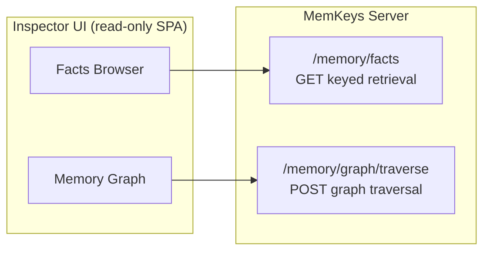
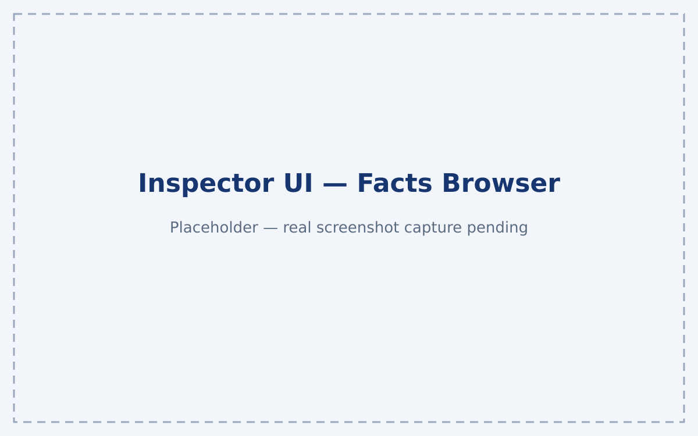

# Inspector UI

The **Inspector UI** is a read-only Single Page Application (SPA) for browsing MemKeys memory. It provides two complementary interfaces for exploring your memory store:

- **Facts Browser** — keyed retrieval by entity attributes with filtering
- **Memory Graph** — graph traversal visualization

The Inspector lives in [`frontend/`](/frontend/) and is served as a static build. The production image is [`ghcr.io/memkeys/memkeys-inspector`](https://ghcr.io/memkeys/memkeys-inspector).

## Architecture

The Inspector is a **read-only** client. It talks exclusively to the public read surface of the MemKeys server:

- `GET /memory/facts` — keyed retrieval
- `POST /memory/graph/traverse` — graph traversal

It never writes, never touches the database directly, and never accesses protected write endpoints.



## Running the Inspector

### Development

```bash
# 1. Start the MemKeys memory server (dev mode on :3000)
cargo run -p memkeys-server

# 2. In another shell, start the Inspector dev server
cd frontend
npm install
npm run dev
```

The dev server runs on `:3001` and proxies `/memory` requests to the server at `:3000`. Open `http://localhost:3001` in your browser.

### Production (Container)

Pull and run the Inspector container:

```bash
docker run -d --name inspector \
  -p 3001:80 \
  -e MEMKEYS_API_URL=http://localhost:3000 \
  ghcr.io/memkeys/memkeys-inspector:latest
```

Then open `http://localhost:3001`.

### Production (Helm)

The Inspector can be deployed via Helm chart (see `charts/` in this repo). Configure the following values:

```yaml
inspector:
  enabled: true
  image:
    repository: ghcr.io/memkeys/memkeys-inspector
    tag: latest
  env:
    MEMKEYS_API_URL: "http://memkeys-server:3000"
```

## Connecting the Inspector

The Inspector requires connection configuration in the top bar:

| Field | Description |
|-------|-------------|
| **Tenant** | Your MemKeys tenant identifier. Required for multi-tenant deployments. |
| **Bearer Token** | Optional. Required if the server runs with a run-token verifier configured. |
| **API URL** | Base URL of the MemKeys server (defaults to `/memory` for same-origin). |

### Connection Checklist

1. **Tenant field**: Set to your active tenant. Without a tenant, no facts will be visible.
2. **Token (if required)**: If your server has `MEMKEYS_RUN_TOKEN_SECRET` configured, provide a valid bearer token.
3. **API reachability**: Verify the Inspector can reach the MemKeys server. For same-origin deployments (Inspector served from the same host as the API), the relative `/memory` base resolves automatically.

## Visualizing Memory

### Facts Browser

The Facts Browser provides **keyed retrieval** by entity attributes. Key features:

- **Entity key filtering**: Search by `project`, `issue`, `pr`, `agent`, `run`, `thread`, `service`
- **Type filter**: Filter by fact type (`decision`, `outcome`, `observation`, `learning`, `context`)
- **Temporal filter**: Filter by `valid` (temporal validity) and `as_of` (point-in-time)
- **Fact detail view**: Click any fact to see full metadata including provenance, timestamps, and supersedes chain

The Facts Browser is designed for the common agent memory use case: "What do we know about issue X?" — a deterministic keyed lookup, not a fuzzy similarity search.

### Memory Graph

The Memory Graph provides **graph traversal visualization**. Key features:

- **Start node selection**: Choose a start node by `kind` + id
- **Direction control**: Traverse forward, backward, or both directions
- **Depth control**: Limit traversal depth to control result size
- **Edge type filtering**: Show/hide specific edge types
- **Traversal metadata**: Displays truncation warnings and dangling edge gaps (never silently hidden)

The graph is a **derived projection** of the keyed store. Each fact projects edges (`entity_fact`, `supersedes`, `produced_by`, `temporal`, `a2a_participant`), and the traversal starts from a chosen node and follows these edges.

## Screenshots

The following screenshots show the Inspector UI in a local development run:




*Screenshots captured from a local dev run (`npm run build && npm run preview` then screenshot at `http://localhost:4173`).*

## Building from Source

```bash
cd frontend

# Install dependencies
npm install

# Run lint and tests (gated in CI)
npm run lint
npm test

# Build for production
npm run build

# Preview the production build locally
npm run preview
```

The production build outputs static assets to `frontend/dist/`, which can be served by any static file server or included in the Docker image.

## Troubleshooting

| Issue | Solution |
|-------|----------|
| **No facts display in Facts Browser** | Check the Tenant field. Ensure the MemKeys server is running and reachable. |
| **"Failed to fetch" errors** | Verify the API URL is correct. For dev, ensure the server is on `:3000` and the proxy is working. |
| **Graph shows no edges** | The graph is derived — ensure facts have been ingested and the graph projection has run (check server logs for derivation errors). |
| **401 Unauthorized** | Provide a valid bearer token if the server requires run-token authentication. |

## See Also

- [What is MemKeys?](/memkeys/what-is-memkeys/) — Core concepts
- [Architecture](/memkeys/architecture/) — Server architecture and retrieval contract
- [Retrieval Contract](/memkeys/retrieval-contract/) — API reference
- [Quickstart](/memkeys/quickstart/) — Store your first fact
