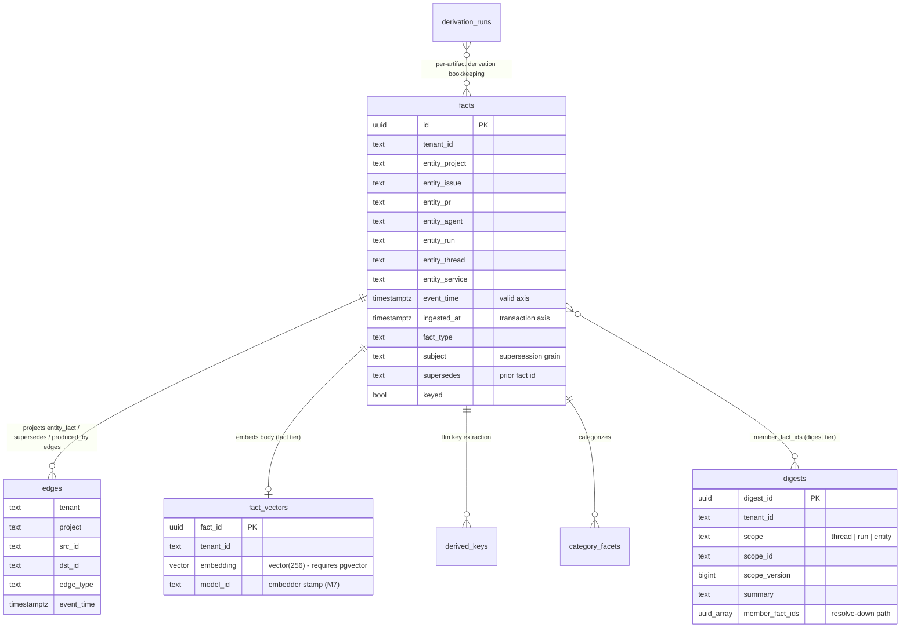

# Instance requirements

What a MemKeys **instance** needs to run: one Postgres, two optional model
endpoints, and nothing else. This page is the provisioning-facing summary; the
design reasoning lives in [Architecture](/memkeys/architecture/) and the full
variable reference in [Configuration](/memkeys/configuration/).

## One Postgres, three logical stores

MemKeys deliberately does **not** deploy a standalone vector database or graph
database. One Postgres holds three logical stores, plus the bookkeeping for
derived artifacts:

| Logical store | Tables | Status |
|---|---|---|
| Keyed / temporal store | `facts` | **Source of truth** — append-only, bitemporal, authoritative for every read |
| Graph projection | `edges` | Derived — rebuildable by replay, never written directly |
| Semantic index | `fact_vectors`, `digests` | Derived — rebuildable; `fact_vectors` needs pgvector |

### The vector database is pgvector

To say it explicitly: **the vector database is [pgvector](https://github.com/pgvector/pgvector)
running inside the same Postgres as everything else.** There is no separate
vector service to deploy, size, or keep consistent. The storage contract is
backend-portable — anything that can filter by field + time range (keyed),
graph-hop (graph), and nearest-neighbor (semantic) can implement it — but
**Postgres is the only backend that ships today**, and `fact_vectors` is a
`vector(256)` column with an HNSW cosine index created by migration `0003`
(which runs `CREATE EXTENSION vector`).

Consequence for provisioning: the Postgres server **must have the pgvector
extension available** — stock `postgres:*` images fail MemKeys' boot preflight
with a clear message. Use `pgvector/pgvector:pg16` (or pg17/pg18) or a managed
Postgres with pgvector enabled. See
[Configuration — required](/memkeys/configuration/#required).

### Graph storage is a derived projection

There is equally no standalone graph database. Graph traversal is served from
the derived `edges` table: a projection of the keyed store maintained
asynchronously after each keyed commit (migration `0002`). Two properties
follow:

- **Rebuildable.** Losing `edges` costs a replay of `facts`, never data.
- **Never written directly.** Only the server's projection worker and
  reconciler write edges; clients and external processes never do.

## Model connections

Model endpoints are **optional and configured, not code dependencies**. An
instance with no model endpoints at all is fully functional for keyed fetch,
graph traversal, and store — only semantic features degrade.

| Concern | Required? | Gating | Configuration |
|---|---|---|---|
| Embedder (fact tier) | Only if semantic search is on | `MEMKEYS_SEMANTIC=1` | `MEMKEYS_EMBED_URL`, `MEMKEYS_EMBED_MODEL` |
| Summarizer + embedder (digest tier) | Only if digest tier is on | `MEMKEYS_SEMANTIC=1` **and** `MEMKEYS_SEMANTIC_DIGEST=1` | `MEMKEYS_GEN_URL`, `MEMKEYS_GEN_MODEL` (+ embedder above) |

With semantic off, `/memory/search` and the `memory_search` MCP tool return
`feature_disabled` rather than empty results — the absence is loud, not
silent.

### Model-change rebuild semantics

Every derived artifact — fact vector, digest, extracted key, category facet —
is stamped with its `derivation_version = (model_id, prompt_version)`, and
every embedded row additionally carries the embedder `model_id` (migration
`0007`). When you change `MEMKEYS_EMBED_MODEL` / `MEMKEYS_EMBED_URL` /
`MEMKEYS_GEN_MODEL` / `MEMKEYS_GEN_URL`:

- the reconciler treats stale-stamped artifacts as backfill work and re-derives
  them off the hot path — **re-embedding and re-summarizing are backfills, not
  migrations**; the keyed source of truth never changes;
- old and new vectors are never silently mixed in one ANN ranking — a stale
  stamp is a re-embed trigger, so correctness never depends on migration
  timing;
- both semantic tiers must use the **same embedder** within a process; change
  it in one place.

## Minimal-instance checklist

**Must run:**

- [ ] Postgres with the pgvector extension available
  (`pgvector/pgvector:pg16`+ or managed PG with pgvector) — `MEMKEYS_DATABASE_URL`
- [ ] One MemKeys process with `MEMKEYS_ROLE` unset (all-in-one) — that's it

**Optional, per feature:**

- [ ] Embedder endpoint (`MEMKEYS_EMBED_URL` + `MEMKEYS_EMBED_MODEL`) — only if
      `MEMKEYS_SEMANTIC=1`
- [ ] Summarizer endpoint (`MEMKEYS_GEN_URL` + `MEMKEYS_GEN_MODEL`) — only if
      `MEMKEYS_SEMANTIC_DIGEST=1`
- [ ] `MEMKEYS_RUN_TOKEN_SECRET` — required the moment you bind non-loopback

Everything else (pool sizing, telemetry, deployment shape) is tuning, not a
requirement — see [Configuration](/memkeys/configuration/) and
[Architecture — process roles](/memkeys/architecture/#process-roles).
